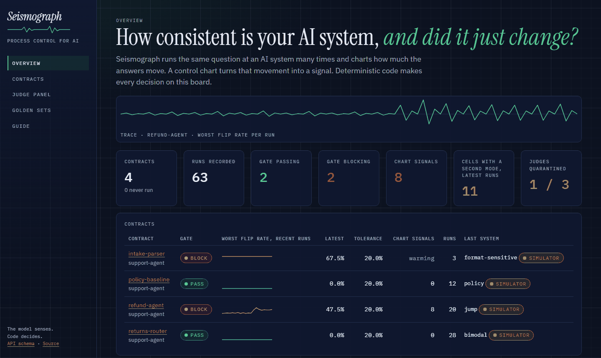

# Seismograph

> **Status: Phase 1 core loop released (v0.3.1).** Contracts compile to plans,
> the sampler and control charts run for real, the golden-defect eval passes its pre-written
> thresholds, and the contract -> run -> report API is persisted and smoke-tested live. The
> full architecture below remains the design; later phases are still to come.
> [ROADMAP.md](ROADMAP.md) shows what exists today versus what is next.

**Statistical process control for AI systems.** Everyone else asks "was this answer good?"
Seismograph asks "is this system stable?", and detects the silent earthquakes (model updates,
prompt edits, dependency drift) that change your app's behavior before your users do.

## What it is

Seismograph is an open-source eval instrument for teams shipping LLM features. Incumbent platforms
center tracing, prompt playgrounds, golden datasets, and LLM-as-judge scoring: single-sample
verdicts on quality. Seismograph centers the question they treat as a footnote: *how consistent is
my AI application, how is that trending, and did anything upstream silently change its behavior this
week?* It treats an LLM application the way a manufacturing engineer treats a production line: as a
stochastic process whose output is a distribution, not a point, and applies decades of industrial
process-control math to it.

Being open source is part of the thesis: teams are rightly wary of piping production traces into a
vendor, and an eval gate belongs inside your CI, not behind someone's meter.

## How it works (the design)

1. **Behavioral contracts as code.** A team declares, in versioned YAML, what must not vary, what
   may vary, and how much variation is tolerable. A deterministic compiler turns each contract into
   an experiment plan. Contracts live in the target repo, version with the prompts they protect, and
   fail builds.
2. **Sample distributions, not points.** For every probe the system under test is run N times across
   M configurations. Outputs are canonicalized, embedded, and clustered into *outcome modes*,
   because the dangerous failure is not noise, it is a hidden second mode the averages conceal.
   Metrics plot onto control charts with statistically derived limits; the headline is the **AI
   Capability Index (ACI)**, a Cp/Cpk-style capability score per feature against its contract.
3. **Metamorphic invariants replace golden answers.** You do not need the right answer to know
   paraphrase, irrelevance, order, and format invariance must hold. An LLM proposes input variants; a
   deterministic back-check (embedding similarity plus NLI entailment) verifies each before it enters
   the probe bank. Perception proposes, verification disposes.
4. **The judge is on trial too.** Every LLM judge is anchored against a small human-labeled set and
   continuously recalibrated. When agreement decays past threshold, that judge's verdicts are
   quarantined and flagged. The measuring instrument gets measured.

## What exists today (verified)

Phase 2 is built: the full invariant set, outcome modes, the judge panel, the CI gate and the
dashboard. Each line below is a command you can run. None of it needs an API key.

1. `python scripts/quality.py`: the measured quality gate. Nine components (coverage, tests,
   lint, types and complexity, backend and frontend), every one at or above 96 or it exits 1.
   The last run is in [quality_report.md](quality_report.md).
2. `seismo gate --contract contracts/refund-full-invariants.yaml --sut policy` exits 0, and the
   same command with `--sut format-sensitive` exits 1. The gate runs every invariant: repeat
   run, irrelevance, order, format and monotonicity. A planted defect trips its own invariant
   and no other (`tests/test_invariants.py`).
3. `python scripts/smoke_test.py` against a running instance: hits real endpoints and asserts
   non-empty, schema-valid data.
4. Set `APP_ENV=production` and call `/api/v1/demo`: returns 503, because fixture data outside
   development is forbidden by code, not by convention.
5. `python scripts/eval.py`: the operating curve, 30 runs per cell with 95% confidence
   intervals. Seismograph detects an abrupt mean shift of 1 sigma or larger in the monitored statistic within a median of 5 monitored points (40 samples per point) at a false alarm rate of 0.017 per point, and it misses below that: a 0.5 sigma shift is caught about half the time (0.50, 95% CI 0.33-0.67) and a 0.25 sigma shift about two times in five (0.43, 95% CI 0.27-0.61).
   The curve, misses included, is in [eval_report.md](eval_report.md) and
   [eval_curve.svg](eval_curve.svg). A missed bound fails CI: the eval job is required.

What it does not do yet: fault attribution, scheduled production monitoring, and benchmarking
across providers are Phase 3 and are not built. See [ROADMAP.md](ROADMAP.md).

## The dashboard



A Next.js static export in `web/`, served by the API itself from `WEB_DIR`. No node process
runs in production. Every number on it comes from the API, or from `EVAL.md` and
`eval_report.md` read at build time. A failed call shows the error. A 401 shows a token form.

| Page | What it answers |
|---|---|
| Overview | Did anything change? Gate state, trend and chart signals per contract. |
| Contract | When, and under what condition? X chart, p chart, invariant matrix, mode topology. |
| Run | Why did the gate decide this? Reasons, the matrix and the outcome modes of one run. |
| Judge panel | Can the scorer be trusted? Agreement with labelled anchors, quarantine, panel verdict. |
| Golden sets | How does it score against labels? Recall, false positives, calibration, drift. |
| Guide | How to evaluate an AI system with this instrument, in seven steps. |

The same guide ships as one file: [docs/guide/seismograph-guide.html](docs/guide/seismograph-guide.html).

```bash
docker compose up -d --build        # Postgres, Redis, the API and the dashboard on :8000
python scripts/seed_demo.py         # optional: record the guide's walkthrough (simulators only)
```

## The unique bet

Existing tools evaluate single samples against quality criteria (the tools we reviewed as of July
2026). Seismograph's bet is that the value lives elsewhere: an open-source instrument for measuring
the *stability* of a stochastic process: contracts as code, control charts with limits derived
from your own baseline, ground-truth-free invariants, and a judge that is itself calibrated against
labelled anchors, as one CI workflow. Component-level fault attribution is the Phase 3 part of the
bet and is not built. "Accuracy 87%" demos better than "Cpk 1.1", right up until the first silent model update
burns you.

## Quickstart (local, zero external keys)

### Standalone clone

```bash
python -m venv .venv
source .venv/bin/activate         # POSIX     (.venv\Scripts\activate on Windows)
pip install -e .[dev]             # groundwork resolves from GitHub automatically
cp .env.example .env              # POSIX     (copy .env.example .env on Windows)
uvicorn app.main:app --reload
```

### Developing the whole portfolio (sibling checkout, editable)

```bash
git clone https://github.com/nuwansamaranayake/groundwork ../groundwork
pip install -e ../groundwork
pip install -e .[dev]
```

The full smoke test exercises `/api/v1/contracts` and `/api/v1/runs`, which persist to
Postgres — bring up the migrated stack first, then run it with the token from
`.env.example` (the server reads its token from `.env`, so the client must send the same
value):

```bash
docker compose up -d          # Postgres + Redis + the migrated service
export API_PORT=8000 SMOKE_TEST_TOKEN=dev-smoke-token && python scripts/smoke_test.py   # POSIX -> SMOKE OK
set API_PORT=8000 && set SMOKE_TEST_TOKEN=dev-smoke-token && python scripts/smoke_test.py  # Windows
```

The `/api/v1/demo` endpoint alone serves the synthetic dataset in `data/synthetic/` with no
OpenRouter key, Postgres, or Redis — enough to see the app respond, but not enough for the
full smoke, which requires the database.

## Demo

The walkthrough is the guide: [docs/guide/seismograph-guide.html](docs/guide/seismograph-guide.html),
also served at `/guide/`. It records the "silent earthquake" scenario with the built-in simulators: a
system whose flip rate jumps at run 12, and one that keeps its decision stable while a second
outcome mode appears. Simulators are labelled as simulators everywhere they appear.

## Use it in your CI

```yaml
# .github/workflows/seismograph.yml
on: [pull_request]
jobs:
  gate:
    runs-on: ubuntu-latest
    steps:
      - uses: actions/checkout@v4
      - uses: nuwansamaranayake/Seismograph@main
        with:
          contract: contracts/refund.yaml
          sut: my_app.eval:sut        # an object with run(probe_input, t, rng) -> JSON text
```

Exit 0 is pass, 1 is block, 2 means the gate could not be evaluated.

## Doctrine

The operating rules this repo is built and reviewed against, fail loud, smoke-test real endpoints,
no silent fallbacks, live in [DOCTRINE.md](DOCTRINE.md).
